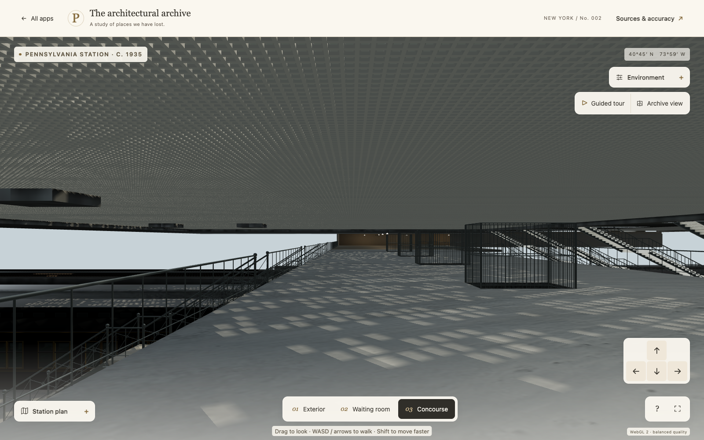
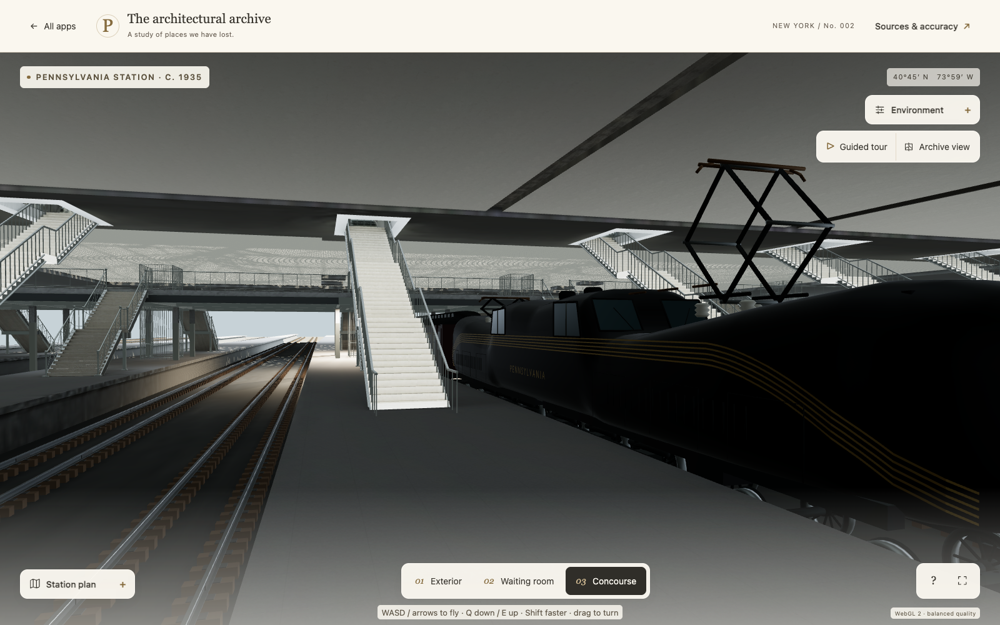
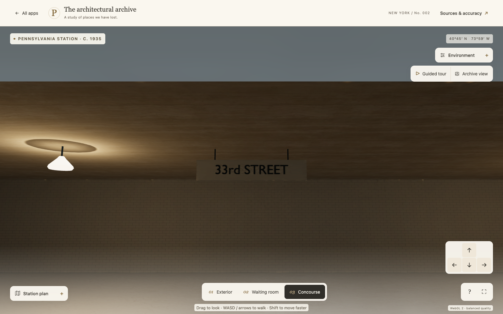

# Gallery finish acceptance

Runtime `11-gallery-finish-1` adds98 fitted fascia/stringer/landing pieces across the first eight ordinary arrival pairs, retaining the existing P5 finish once. The small physical street-exit sign has separate readable faces, opaque backing, actual ceiling supports and2.2376m head clearance. Existing station geometry, treads, landings, navigation and ten other model transports remain unchanged. The ordinary floor alone receives the modern, qualified concrete PBR appearance.

The accepted4K/128sample Metal bake includes all101 opaque source pieces and excludes only the two lettering meshes. All98 original finish owners appear in the recorded pre-bake census. Authored hard-face normals are carried through join/UV preparation before transport; the final source comparison measures0.02857degree maximum normal encoding change, within the existing0.5degree Blender codec bound,7.629micrometre position change and zero UV0 change. Raw→encoded→mounted attributes have zero additional drift. The rejected earlier90degree corner reassignment remains a separate HOLD record.

Physical route, complete-model validation and actual browser records accompany the final frozen acceptance. Browser walking walkthrough remains omitted at the owner's request. Static camera checks do not establish a native walking, physical mobile or FPS result.

The floor uses modern ambientCGConcrete034 underCC0, an appearance interpretation rather than an authenticated historic floor sample. Its physical texture tile is1.1×0.55m; all three maps are packed in the editable material source. Mean linear albedo, existing geometry/UVs, AO and GI remain intact. The physical sign's placement, font, size and hue remain inferred from the period destination-sign family.

Publication is recorded after the matching Pages deployment. The station remains a phased reconstruction with northern/LIRR registration, further platform/enclosure work, furnishings, final realism and the wider city still unfinished.

Final checks pass: all12 GLBs have zero validation errors and107 shared KTX2 images. The referenced model/texture/light/probe transfer is240,218,826bytes across both quality variants. Actual full/fallback geometry passes3,168 stair and6,252 exit-route samples, plus road/curb checks and base-prefix preservation. The exact source, encoded and mounted input hashes match.

Actual Chrome static views of the gallery, platform and sign pass with six visible areas. Both new gallery materials bind4096px lighting at scale2. Floor color/normal/roughness maps bind at2048×1024 with proper color/data transfer, normal strength0.22 and physical UV scale. Page, HTTP and unexpected console errors are zero; raw local cancellations remain explicit. No keyboard movement or walking walkthrough was performed.

These current screenshots also show that the wider railway enclosure and some street-roof transitions remain unfinished. This release completes the specified fascia, stair-junction and surface pass, not the full lower station.

Visual release `e8315ae5b563d3281fc9668f4a9b9d3c0bd4be29` is live: matching [Pages41734903984](https://github.com/stavreskimario/stavreskimario.github.io/actions/runs/41734903984) and [site checks41734920478](https://github.com/stavreskimario/stavreskimario.github.io/actions/runs/41734920478) pass. Fifteen actual public response bodies match the committed HTML, renderer, full/fallback concourse, both new GI maps, metadata and all eight new KTX files exactly. Local native static checks remain separate; no native public browser or walking walkthrough is claimed. [Open the update](https://stavreskimario.github.io/penn-station-1935/?preview=e8315ae).
