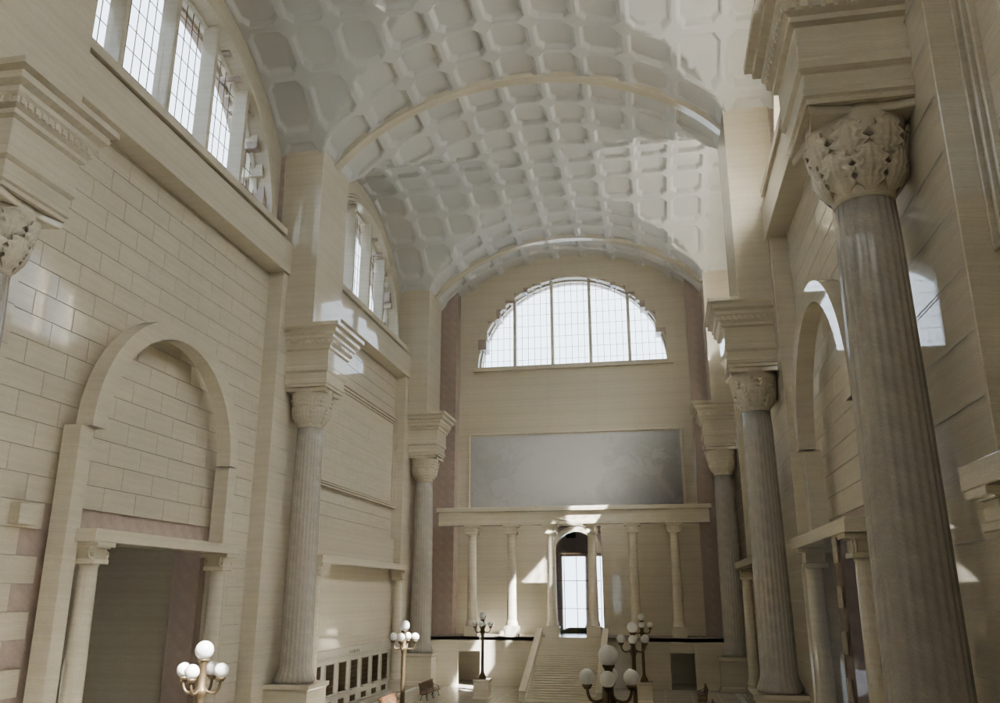

# Revision 4 architecture and finish geometry

The immutable original full-core source and native north-mural crop are in [source/](source/). The [earlier delivery receipt](architecture-delivery.json) identifies that pass and its small revision 2 floor patches. The broad visible central-court floor is superseded by [revision 3](../concourse-details/floor-v3/source-reconciliation.json), which records the current editable scene/manifest, canonical source and actual-triangle checks; the earlier source and reports are retained. Raw rooms use Main = 0; the saved scene already places Main at world −4.2672 m. The source preview and neutral diagnostic are actual Blender renders, with their lighting limitations identified separately from the final browser experience.



This CPU Cycles preview uses the final editable geometry, the current interpreted PBR library, directional daylight and an interior photographic exposure. It is a source render while the separate browser lighting is baked, rather than a browser screenshot. [Render settings, source hashes and limitations](source-preview/source-render.json) accompany it.

## Corrected defects

| Before | After | Why |
| --- | --- | --- |
| Axis-Y arch shells inherited the winding of the opposite-handed X parameterization | Reverse winding for axis Y; preserve axis X | Correct the visible black rib/arch bands and the surface used by light transport |
| Large coffer faces crossed the vault as warped polygons; 648 main-field faces deviated over 20 mm from a plane, up to 742 mm | Resolve the same profile on constrained curved triangles with matching shared-edge samples | Preserve actual curvature instead of relying on arbitrary triangulation of warped quads |
| Normal-offset relief folded where the two barrel normals meet at a groin | Use continuous vertical relief over the vault, retaining the existing five bands | Remove self-overlap and black slivers; the exact relief depth remains reconstructed |
| Right and bottom capital-leaf edge faces faced inward | Consistent closed-leaf winding | Correct the shading and light transport of the existing interpreted leaf form |
| Rounded gable coordinates overlapped both roof valleys by 60 mm | Three roof bays share exact hall-derived boundaries | Remove duplicate valley strips while retaining crown and shell ends |
| Twelve-segment low-resolution globes shared clock/sign white and occupied one height | Smooth 48×24 globes, a raised centre over four lower branches, separate opal material and connected supports | Follow the candelabrum hierarchy visible in S23 and plate 306, with an independently adjustable milky-glass interpretation |

The coffer field retains its nominal 10 ft projected module, octagonal outline and interpreted relief bands. It contains 297 cells over the three principal bays and 44 over the end porticos: 341 in total. The final raw plaster mesh has 150,832 explicit triangles and preserves the adopted 143 ft crown. The main-field curved audit has no warped polygons or zero-area triangles. This does not certify the historic cell inventory or a measured 360 mm carving depth; the source describes that relief as a vertical reconstruction.

The same capital profile now uses a finer 40×20 leaf grid, 96-segment bells and a continuous 96-point concave abacus outline without duplicated corner vertices. This sharpens the existing forms and their shadows. It does not authenticate every lobe, moulding or carving as a fragment scan. Published order heights and the existing bearing datums remain unchanged.

## Evidence and scoped verification

- The [detail audit](detail-audit.json) checks both arch axes with circular and elliptical controls. All four refined controls face the expected direction. A negative control from checkpoint `b86a591` reproduces all 192 inward faces in its axis-Y control and 62 inconsistently oriented leaf edges; the refined leaf has zero inconsistent shared edges.
- The [full source contact audit](architecture-contact-audit.json) records 2,490 checks with zero failures. It includes nineteen standard/foot/branch/cup/globe mounting checks for each of eight candelabra and four supported booth friezes. Its scope is architectural attachment, not structural engineering certification or every joint in the station.
- The [roof control](roof-valleys.json) records both former 60 mm overlaps and both corrected zero-overlap boundaries, with the same 167 ft crown above Main.
- The [vault identity proof](vault-source-identity.json) shows that the clean early ceiling input and final whole-room raw export have identical plaster positions, normals, UV0 and indices. Whole-room occluder changes remain distinct from that geometry identity.
- The [concourse source audit](concourse-detail-audit.json) accompanies the closed perimeter/window and prism-field layer. Its separate review records the primary evidence and detailed qualifications. Actual browser walking, model loading, illumination transfer and performance remain parent delivery checks.
- [Raw glTF validation](raw-gltf-validation.json) reports zero errors in all three new architecture exports. The five exterior, four waiting-room and three concourse warnings all concern runtime-generated tangent space for normal-mapped materials; they are retained in the record. Validation of the compressed delivery models is separate.

The candelabra’s raised centre and four lower curved branches are photograph-led. The exact bronze profiles, dimensions, placement, colour, optical values and any practical-light output remain interpretations. The globe tops used here are 6.5755 m and 5.915 m above Main; those numbers are implementation dimensions, not authenticated surviving measurements.

## Historical limits retained

The 143 ft / 150 ft finished-ceiling statements remain a documented source conflict. Finer carving and coffer sampling do not resolve it. The north mural remains a native 728×260 monochrome rectification from LOC det.4a23713; enlarging it would not recover additional detail. Five other fields remain neutral. Fine ornament, exact 1935 furnishings/signs, colour calibration, complete historic passenger figures and the fuller Manhattan surroundings remain unfinished.

Rebuild the immutable architecture from the repository root with pinned Blender:

```sh
uv run --no-project --python 3.11 --with bpy==4.3.0 --with 'numpy<2' python authoring/penn-station-1935/review/phase4/architecture/source/model/build_station.py --out ~/Desktop/penn-station-frozen-review --no-context --only core
```

Material preparation, calibrated lighting, compression and browser validation are separate from this raw geometry build. See the parent validation record for the final delivered assets and publication status. No claim of a 1:1 replica or completed photographic fidelity follows from these source checks.
