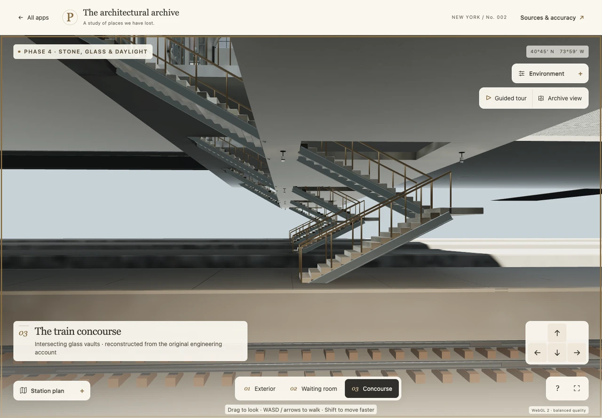

# Final exact-asset navigation

All four navigation groups pass on frozen bundle `67be7080829be131857745192d7f08af499b43396f601ee3240c2e70d220e1e4` and manifest `2198c77988f86d73944425e4a6195653d904b1e503660a8467c93dedeab10c6c`. Every asset and bundle file remains byte for byte identical to `freeze.json`; each receipt also matches all twelve full/fallback model hashes.

- The full waiting-room–concourse–main stair–both doglegs–Platform 5 roundtrip passes **17 actual keyboard legs** and **4,936 rendered samples**, then returns to waiting-room eye height. No platform shortcut, camera setter, pose reset or arrival correction is used.
- North and south prism crossings pass six legs and 3,776 samples, with 5,192 actual upward-glass support hits. The complete six-zone world and human eye height remain continuous.
- Disabling only structural-glass recognition locally produces zero held progress into an actual aperture, zero glass supports and an empty downward support ray. Concrete webs remain solid; other window glazing stays outside support.
- Existing desktop WASD/QE/Shift, camera/target coherence, deceleration, native-field/dialog and blur guards pass. The existing brief 390-pixel touch-pad regression also passes; mobile optimization remains deferred.

The first flight attempt is retained in `first-flight-before-pose-commit/report.json`. It sent W before the newly selected pose had committed; the existing pose-reset effect cleared that held input. Only flight was rerun after a test-only readiness wait. The successful receipt records the actual exterior position `[145, 8, 88]`, render frame advancement from 112 to 116 before input, then 6.43 metres of W movement. Original movement, focus and guard assertions are unchanged. No production source, assets or bundle changed during these checks.

`summary.json` is the consolidated result. Per-case reports retain all route legs and compact sample summaries; native screenshots and full sample traces remain in `/Users/stavreskimario/Desktop/penn-station-work/phase4-final-navigation-visual-2`. The single archived platform image is a 1280-pixel WebP derivative for a compact review; its original PNG remains in work.

Chrome used the observed Apple M5 Max Metal driver. All successful contexts have no page or required-resource errors. These are navigation checks, separate from historical accuracy, final visual inspection, published-site validation and broader hardware performance.

