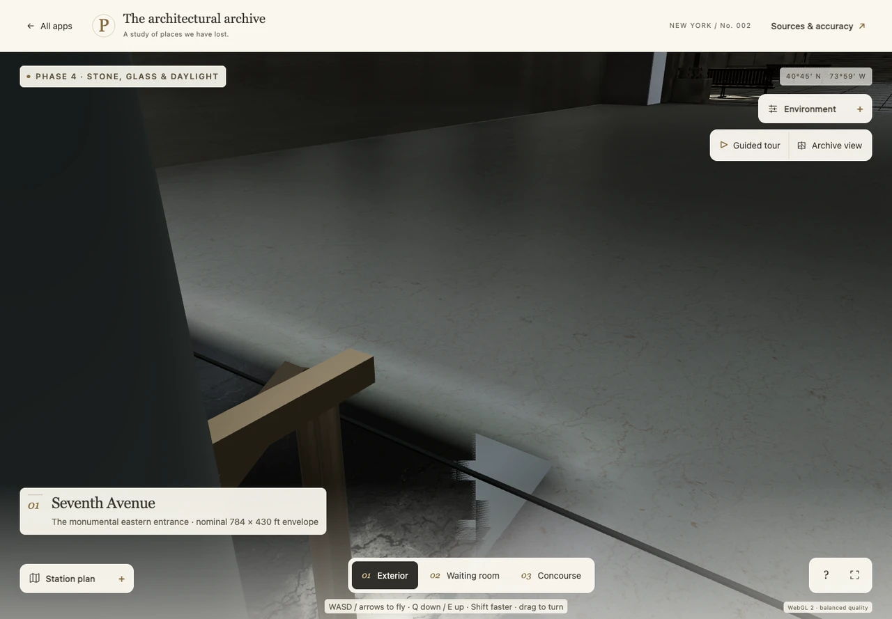

# Corrected concrete with retained lighting UVs

The physically corrected concrete module initially lacked UV0, while its authoritative material still referenced AO and baked illumination. That mismatch caused `MESH_PRIMITIVE_TOO_FEW_TEXCOORDS`; dropping the maps would have concealed the problem. `model/transfer_floor_lighting_uv.mjs` restores the original atlas correspondence without changing the corrected shape or its material.

| Before | After | Why |
| --- | --- | --- |
| Corrected floor geometry has no UV0 for its retained AO/GI material | Original chart correspondence is transferred per triangle corner | Keep the physical floor repair and its established lighting together, with a valid exported model |

The source is recovered from immutable commit `60563ab11c1d83c9b21badcd7fbd7b21efa66473`, not the already modified runtime directory. Desktop transport SHA-256 is `0505d04338aacb21df6d47ed07cdd4dca6af976e22743eba5f93ac83f6d8c79c`; fallback is `eeafebb05ee86f0f8a3f18a4b15120dce9696b2eb6cc7b1bfc73947a0cd08403`. The existing texture-free decoder reads raw/Meshopt attributes and node transforms without loading images.

## Transfer and guards

Each destination triangle selects one original face chart from its centroid and orientation, then obtains all three UV corners through that same face's barycentric mapping. Vertices are expanded per corner to preserve seams; independent nearest-vertex UV assignment and welding are not used. Old position, normal and other attribute corner bytes remain exact, and an independent decode compares every resulting world-space triangle and attribute.

All **1,788 exposed top triangles / 5,364 corners** satisfy normal agreement of at least 0.99 and a maximum 3 mm projection gap. The observed maximum is **1.041 mm**, reflecting the old delivered plane's quantization. Each transferred exposed corner is also checked against actual nearby finite source faces: maximum UV disagreement is approximately `2e-15`. Extrapolation across an original triangle diagonal is allowed only when this confirms the same valid chart; crossing a genuine atlas seam is rejected.

The **178 orientation fallbacks** are confined to the known marble-cover footprints from the physical repair. Only these buried steps/walls may use a nearest valid chart, with a 225 mm distance limit; observed maximum is 218.96 mm, consistent with the existing 200/220 mm finish cover. This is an explicit hidden-surface approximation, not a new exposed-floor unwrap or a removed bake.

Both output modules are byte-identical, SHA-256 `c5a561dab9bda4b0b78caaab2876c7d09b6f42912d269df4f55bbb133dc0c8ba`: the released variants retained identical concrete charts. They contain the same **5,540 physical triangles**, expanded from 4,471 shared vertices to 16,620 corners. No geometry, normals, floor levels, openings, material records, AO images or GI images were changed by this UV task.

## Validation

- Eight synthetic controls exercise deliberate shared-position UV seams, 1 mm plane projection, unchanged shape/normal data, rejection above 3 mm, rejection of a triangle spanning incompatible charts, and the bounded buried fallback.
- Both merged model variants have **zero glTF validation errors**. The missing-UV error is gone. Retained warnings are recorded in `validator.json` rather than presented as errors or silently removed.
- A separate actual-browser comparison uses three matched camera poses with all six zones visible. It confirms retained 2048 AO and 2048 illumination on channel 0, removal of the jagged overlapping concrete patch and preserved surrounding marble/detail. The subsidiary interior view retains its original darker appearance. No geometry hiding or FPS claim is involved.

Compact reports and review derivatives are included here. Native screenshots, the complete per-triangle correspondence arrays and original source files remain under `/Users/stavreskimario/Desktop/penn-station-work/phase5-floor-uv` and `phase5-floor-uv-browser`. The images below are 1280-pixel WebP review derivatives; their original PNGs remain in work.

This is a bounded floor checkpoint. It does not establish final Phase 5 ceiling/material acceptance, a full historical replica or complete photographic fidelity. Root owns runtime promotion, publication and its validation; this task did not edit application source, assets or the built bundle.

