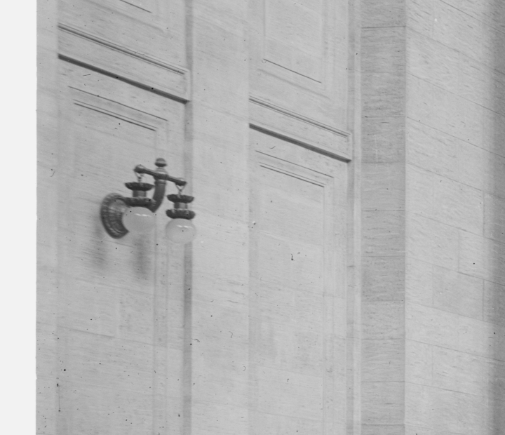
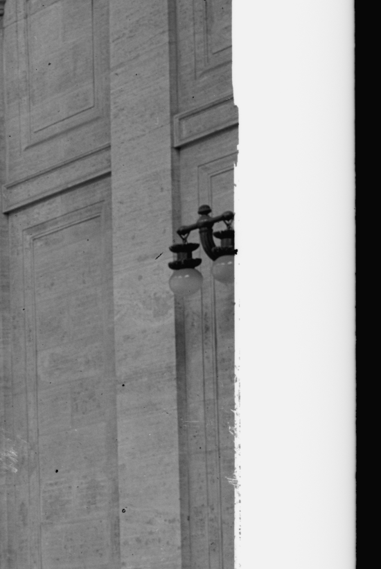

# Waiting-room wall brackets

## Diagnosis and bounded change

At baseline `60563ab11c1d83c9b21badcd7fbd7b21efa66473`, the waiting room has eight five-globe floor standards but none of the photographed twin-globe wall brackets. The previous limitations review already identified unfinished wall-mounted lights. This module adds only the two clearly visible foreground long-wall fixtures, using linked geometry. It does not assert the complete lighting inventory in 1935.

| Before | After | Why |
| --- | --- | --- |
| Bare outer-bay office-screen panels where the original photograph shows wall brackets | One photographed bracket on each foreground long-wall panel, with a moulded round rosette, swept support, curved twin arm, stepped hanging cups and downward globes | Recover a specific missing interior fitting without adding generic decoration or unseen repeats |

## Primary evidence

- [Detroit Publishing negative 071928, Library of Congress S23](https://www.loc.gov/item/2016815386/), original digital file `det.4a23713`. The two included crops are mechanical extracts from the existing 5076 × 4061 TIFF, SHA-256 `b11e92e022cd1aec75b78c3164f35bc2e7772a336f4d31029e2f2ed9665f5d9d`. The left fixture resolves the complete construction vocabulary; the opposite fixture is partly cropped by the original photographic border but corroborates the paired form and corresponding wall location. No restoration, colourization or generative detail was applied.
- [George Gibbs, ASCE Transactions 69 (1910), S10](https://ascelibrary.org/doi/10.1061/TACEAT.0002223), printed p. 269, original-volume PDF page 461 (one based). The original scanned page was visually checked. It distinguishes the main waiting room's two rows of post clusters from limited side-bracket wall lighting, with the high ceiling deliberately less illuminated at night. [Original volume](https://archive.org/details/transactionsofam69amer).

The photograph is opening-era evidence. Its existing S23/S27 registration record narrows publication to 1911; it does not establish the exact exposure date or independently verify that every fixture remained unchanged in 1935. LOC reports no known publication restrictions; the source is an original pre-1931 United States publication. The full TIFF/PDF remain in research work rather than being duplicated in this archive. `evidence.json` records crop rectangles, source hashes, rights, page locators and limits.

## Placement and uncertainty

Exactly **two** fixtures use the existing southern outer-bay panel centres at Blender Y = −28.144 m. Rosette back planes are X = ±15.655 m; their centres are Z = 8.600 m above Main. The current structural screens identify a real supporting surface. `support-rays.json` independently records 18 actual-source triangle hits over both 0.44 m rosette footprints, with exact wall coordinates and inward normals.

These are photograph-led bay registrations, not surveyed fixture coordinates. The adopted 1.00 m overall span, approximately 0.535 m projection and 0.80 m overall height are **inferred**, as are small offsets, casting profiles, metal finish and globe optics. The bracket silhouette and component hierarchy are supported; alloy, calibrated colour, glass composition, photometry and exact 1935 retention are unverified. The module reuses the existing interpreted `AgedBronze` / `OpalCandelabraGlass` palette. No live lights, wiring inventions, clock placements or extra unseen fixtures are added.

The unchanged exterior clock remains a separate research opportunity: Gibbs p. 267 describes internal clock-case lamps, while the current code names an opaque stone dial. This module does not change that clock, resolve the conflicting six/seven-foot descriptions, or broaden the exterior scope.

## Isolated authoring and integration

`source/build_wall_brackets.py` authors only this family in Blender 4.3. Its raw, uncompressed outputs remain outside runtime assets:

- `/Users/stavreskimario/Desktop/penn-station-work/phase5-interior-details/waiting-wall-brackets.blend`
- `/Users/stavreskimario/Desktop/penn-station-work/phase5-interior-details/waiting-wall-brackets.glb`

The GLB is 235,428 bytes, SHA-256 `e3cbbaff65d1dc5794983105ce67c9c9662d54bc360f39e11622c39db03c4498`. Four mesh nodes share two meshes, adding 21,824 instanced triangles, two material references, zero textures and zero lights. Root owns offline integration, material remapping and delivery compression. Existing architectural buffers/maps must be retained; remap module materials to the authoritative existing materials instead of replacing them.

**Datum:** Blender module Z = 0 is Main. The GLB uses Main-local Y-up coordinates. Merge directly into a raw waiting-room chunk; its app group applies the −4.2672 m lowering. When appending the collection into the already lowered canonical Blender scene, apply that lowering exactly once. The isolated scene was saved without cameras, helper walls or lights. No canonical scene, application source, runtime assets or built bundle was changed by this work.

## Checks and remaining acceptance

`module-audit.json` records eight closed positive-volume component shells and seven actual-mesh connection checks per linked fixture, including wall plate/support, central stem/crossarm, cups and globe crowns. `export-roundtrip.json` independently decodes the exported GLB, checks positive volumes and closed edge topology after position welding, confirms shared geometry/no textures/no lights and records actual bounds. Wall support uses the separate actual station-source rays, not a fabricated support plane.

These are authoring/geometry checks. Final placement review against the historical image, an integrated close view, material consistency, compressed-model validation and browser performance remain parent integration checks. This module is not yet a delivered feature or a complete historical lighting reconstruction.

