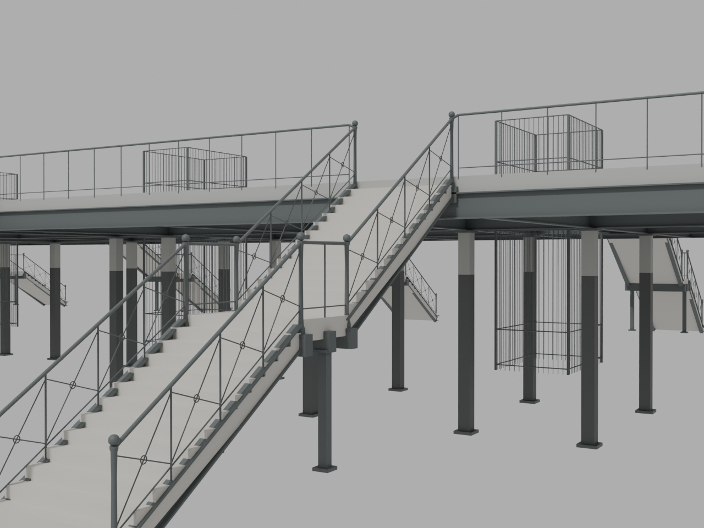
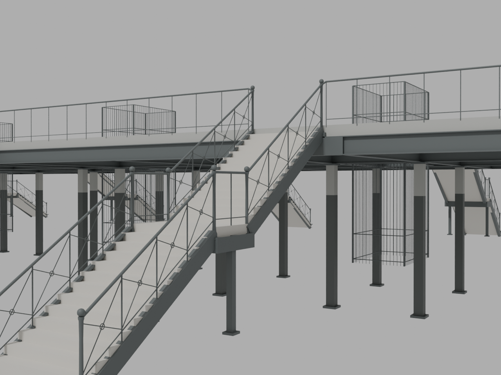

# Unpublished P5 flat-face appearance study — source checkpoint

This preserves **14 inferred flat finish objects** in existing P5 stringer, landing and gallery-edge recesses. All 4,047 original arrivals components, their positions, normals, surface UVs, materials, fixtures and source bindings remain exact. The nominal 8 mm thickness and cover-face fabrication are appearance interpretations. This is not a completed gallery or historically finished stair, and it changes no published station geometry, assets or canonical scene.

Root accepts the limited flat-face comparison below. The existing angular landing/stringer and handrail transitions remain visibly different from the curved primary-photo family. Curved haunches, rail returns, ornament profiles and historically verified finish/fabrication remain held. The primary crops show a representative arrival-stair family; neither authenticates a P5 camera location. The rounded upper-Main fascia is a separate level from the lower Exit edge.

| Existing component geometry | With the 14 inferred flat faces |
| --- | --- |
|  |  |

Both unedited CPU renders use the same camera and neutral review illumination. The before hides only the 14study objects. They omit the platform and surrounding station context because this is a component study; visible isolated supports are not a change to the live station. These are not final browser/PBR renders or calibrated historical camera matches. [Root visual qualification](visual/root-visual-review.json) and [independent primary-photo review](photo-review/README.md) retain the limits.

## Preserved authoring and exact recovery

- `artifacts/addon.blend` is the exact editable 14-object Blender scene; `finish-addon.glb` is its exact 264-triangle export.
- The complete source-plus-study GLB is losslessly archived. The original ba096 GLB is recovered byte-for-byte using its archived original header/JSON and the unchanged original BIN prefix inside the combined GLB. The duplicate 3.38 MB source-GLB archive is omitted.
- The complete 5.19 MB original study manifest, source proof, full contact review and detailed raw routes are retained as lossless gzip, not abridged statistics.
- `source/build_study.py` is the exact frozen portable authoring CLI. Proposal, source/input pins, source-photo audit, reviewer helpers and both render receipts/helper are retained.
- The original full `editable.blend` 6.75 MB derivative is retained externally with a verified lossless backup and exact identities in [full-editable-external.json](full-editable-external.json). It is explicitly omitted from the repository. Regenerating the complete scene reproduces both GLBs byte-for-byte and all source/new-component states, but **does not claim identical full.blend serialization bytes**.

[Actual portable CPU replay](evidence/portable-replay-proof.json) reopens the rebuilt 4,061-object full scene and the exact packaged 14-object addon. All 4,047 source component/material states and all 14 skin records match the frozen study. No rendering, GPU operation, root modification or dependency installation was used for that replay. Rejected candidate-v1/all-scenes export, duplicate archives, voluminous import/render logs and historical-photo raster files are not redistributed; accepted outputs and full proof data remain retained.

## Reproduce outside the repository

Use Python 3.11 with bpy 4.3.0/numpy 1.26.4 for the CPU replay. Select a new external destination; recovery and replay refuse to overwrite an existing directory. From this handoff directory:

```sh
PYTHONDONTWRITEBYTECODE=1 python source/recover.py --out /tmp/p5-source-recovery-unique
PYTHONDONTWRITEBYTECODE=1 python source/replay.py --out /tmp/p5-authoring-replay-unique
```

The first command uses only the Python standard library and recovers the exact base, combined study, addon and source proof. The second requires the pinned Blender Python environment and rebuilds the editable scene, validating both raw GLBs and component/material states. Output directories contain their own recovery/replay receipts. Do not use the preserved historical absolute paths in JSON as required filesystem locations; they document the original run.

For the independent CPU geometry review, set `PENN_TOOLS` to the isolated installed Node dependencies recorded in [toolchain.json](toolchain.json), then run against one fresh replay:

```sh
node source/review-p5-finish.mjs --source /tmp/p5-authoring-replay-unique/source/arrivals-module.glb --candidate /tmp/p5-authoring-replay-unique/rebuilt/p5-study-source-plus-finish.glb --manifest /tmp/p5-authoring-replay-unique/rebuilt/study-manifest.json --proposal proposal/PROPOSAL.json --adjacency /tmp/p5-authoring-replay-unique/source/source-adjacencies.json --out /tmp/p5-review-unique
```

Portable reviewer copies change only import/tool paths; [source-derivations.json](source-derivations.json) pins the exact original and derived code. Original reviewer/control scripts are retained separately. The established whole-station walking harness additionally needs the exact retained-context assets identified in its receipt; those large unchanged runtime files are not duplicated here.

## Evidence and remaining gates

[Independent geometry controls](evidence/independent-summary.json): 14 objects, 18 closed positive-volume parts, 42 literal full-area contact rules, zero exposed coplanar duplicates and 88 preserved actual source adjacencies. No numerical boundary allowance was needed. New outward normals pass; all original geometry/normal/UV/material bytes stay exact through original BIN/JSON prefixes.

[Raw walking regression](evidence/raw-walking-summary.json) passes 96 arrival routes/39,696 stair samples, 4 gallery connectors/9,084 samples and 80 fixture rays in each retained full/fallback context. Both contexts use the same **unencoded** new study geometry. This is not encoded-LOD or native-browser acceptance of the 14faces.

Fresh lighting/AO, full/fallback encoding, final route/contact and native visual checks are required before any web integration. Curved silhouettes and rails need a separate source-backed geometry stage before repeating beyond P5. Northern/LIRR registration, street exits, lift assignments, unresolved transfers and local soffit datums remain held. Opening-era photographs do not certify all 1935–1940 details, colours or construction. No final photorealism, performance, physical-mobile, WebGPU, historical-capacity or completed-gallery claim is made.
