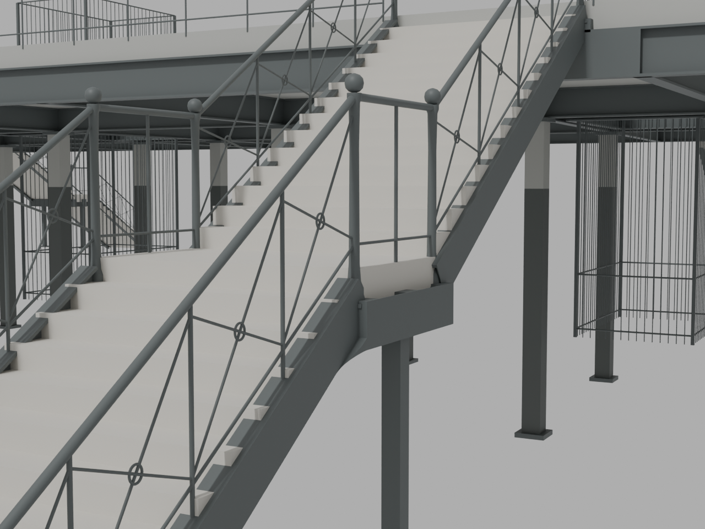

# P5 bounded source checkpoint: first west curves and paired flat faces

This preserves **six editable west-P5 handrail curves, two west lower-haunch appearance volumes and the earlier 14 flat finish objects across the P5 stair pair and gallery edges**. The 22-object Blender addon contains six existing rail replacements and 16 additions. Only the six explicitly owned rail mesh definitions change in the complete raw GLB. All other original geometry, transforms, surface UVs, normals, materials, fixtures, treads, landings, newel anchors and structural members remain exact.

This is the first **west** curved-profile checkpoint, not a completed gallery or a finished historical stair. Upper haunches remain held, and the east handrail curves are unchanged. The 150 mm nominal handrail bend radius, lower-haunch polynomial and fabrication are inferred. The photos support the lower arrival-stair outline family and smoother handrails; they do not identify P5, establish an exact radius or certify all 1935–1940 details. The upper Main-concourse fascia is a separate level and has not been copied onto the lower gallery.



The unedited image is an actual Blender Cycles CPU study with neutral review light, not a browser screenshot, final PBR render or calibrated historical camera match. [Root visual review](visual/root-visual-review.json) accepts this bounded source geometry for fresh lighting. It does not accept the remaining upper transition or claim complete historical construction. [Photo audit and tread/curvature addendum](photo-review/TREAD-CURVATURE-ADDENDUM.md) retain the evidence limits. Historical source-photo rasters are not redistributed.

## Editable source and recovery

- `artifacts/p5-curved-editable-addon.blend` is the exact 22-object editable addon. Six Bezier spines retain Geometry Nodes Circle → Curve to Mesh → Set Material, using the existing guard iron. The 16 meshes are the original 14 flat faces plus two localized lower haunches. The haunch loft varies laterally from approximately 8 to 68 mm; it is not a claim of constant-thickness sheet construction.
- The complete accepted raw GLB is archived losslessly. It preserves the original base and flat-study BIN prefixes, including the original six rail bytes. Archived original headers/JSON recover **both ba096 base and ba8516 flat GLBs byte-for-byte** without duplicating their large binary payloads.
- Both complete frozen study manifests and the original source proof are lossless archives. The source files retain the exact original builders beside a narrowly derived portable curved builder. The latter replaces only a full.blend binary identity assumption with frozen component/material-state checks. It changes no geometry, material or export math.
- The exact full `editable-curves.blend` remains external with a verified lossless backup in [full-editable-external.json](full-editable-external.json). Replaying the packet reproduces the final raw GLB exactly and the full scene logically. It **does not claim identical regenerated full.blend serialization bytes**.

[Actual CPU replay](evidence/portable-replay-proof.json) rebuilds the flat scene and then the curved scene. It reopens the regenerated 4,063-object full scene and the exact 22-object addon, checking all 4,055 nonowned source objects, all original material graphs, all 22 component states and actual evaluated rail-face material bindings. The accepted raw GLB is reproduced byte-for-byte as `024e8cff461f7cdb1080652412e52b210495fdaf1d4e1d75945dcce6f4f6d98f`.

## Resume outside the repository

Use Python 3.11 with bpy 4.3.0 and numpy 1.26.4. Recovery requires only Python's standard library; replay additionally requires the pinned Blender Python environment. Choose fresh external output directories. These commands refuse to overwrite existing output and never render, use the GPU or save the canonical scene.

```sh
PYTHONDONTWRITEBYTECODE=1 python source/recover.py --out /tmp/p5-curved-recovery-unique
PYTHONDONTWRITEBYTECODE=1 python source/replay.py --out /tmp/p5-curved-replay-unique
```

For the portable independent geometry review, set `PENN_TOOLS` to an installed directory containing the versions in `toolchain.json`. The explicit inputs below point to a completed replay:

```sh
P5_FLAT_GLB=/tmp/p5-curved-replay-unique/source/p5-flat-source.glb \
P5_FLAT_MANIFEST=/tmp/p5-curved-replay-unique/frozen/flat-study-manifest.json \
P5_ADJACENCIES=/tmp/p5-curved-replay-unique/source/source-adjacencies.json \
node source/review-curves.mjs /tmp/p5-curved-replay-unique/rebuilt-curves /tmp/p5-curved-review-unique
```

[Source derivations](source-derivations.json) list every portability change beside exact original script hashes. The ownership checker accepts source/candidate/manifest paths directly. Full original walking and evaluation scripts remain provenance records; walking additionally requires the exact retained station context assets named in the receipt, which are not duplicated here. Preserved original absolute paths document their original run and are not required replay locations.

## Acceptance and remaining gates

[Independent review](evidence/independent-summary.json) passes 42 retained flat contact polygons, four haunch contact strips, 88 original adjacencies, 12 prior rail/newel/finial receiver checks, eight closed positive-volume owned/addon meshes with outward normals, 562 two-sided interior rail sections, 12 complete endpoint caps and four connecting profile rings. The two previously detached finials now have 2.213 mm vertical solid overlap. Two haunch end-strip checks use the established explicit numerical boundary allowance; this is not a claim of literal exact polygon-area coincidence. Analytic Bezier spines are C1; the exported 32-sided tessellated surface is finite geometry.

[Raw walking](evidence/own-cpu-summary.json) passes 96 arrival routes/39,696 stair samples, four gallery routes/9,084 samples and 80 fixture rays per retained full/fallback neighbor context. Both use the same unencoded study geometry. All 13 actual input files were rehashed after checks. Earlier failed contact, finial and cap-plane diagnostic receipts remain in the independent evidence archive. They are not promoted acceptance.

Fresh lighting, full/fallback encoding, final assembled physical checks and native six-zone browser review are separate gates before any live integration. Upper haunches, remaining finish/fabrication interpretation, other stair bays, northern/LIRR registration, street exits, lift assignments, unresolved transfers and local soffit datums remain held. No final photorealism, performance, engineering-capacity or completed-gallery claim is made.

## Canonical source and superseded packet

[Read-only C4 compatibility](compatibility/SUMMARY.json) verifies the six existing owner names and Main0 → Street0 translation, retaining each new haunch's local transform. Existing canonical material graphs must be reused, including both Curve slots and GN Set Material. The historical full builder deletes the scene, and its MESH/FONT-only export omits Curve objects. A dedicated external six-replacement/16-addition patch and evaluated-copy export roundtrip are required. The 82 MB canonical file has not been modified, saved or exported.

This proposed packet supersedes the earlier flat source packet at the same directory only after root review. [Supersession and recovery](SUPERSESSION.md) pins immutable commit `89035a4f09fcf43046c3651d6473de20f270e299` and a verified external backup of every prior file. The original flat sources and backup are retained. The replacement proposal avoids a second large base payload and duplicate before/after PNGs; no source history or evidence is silently deleted.
