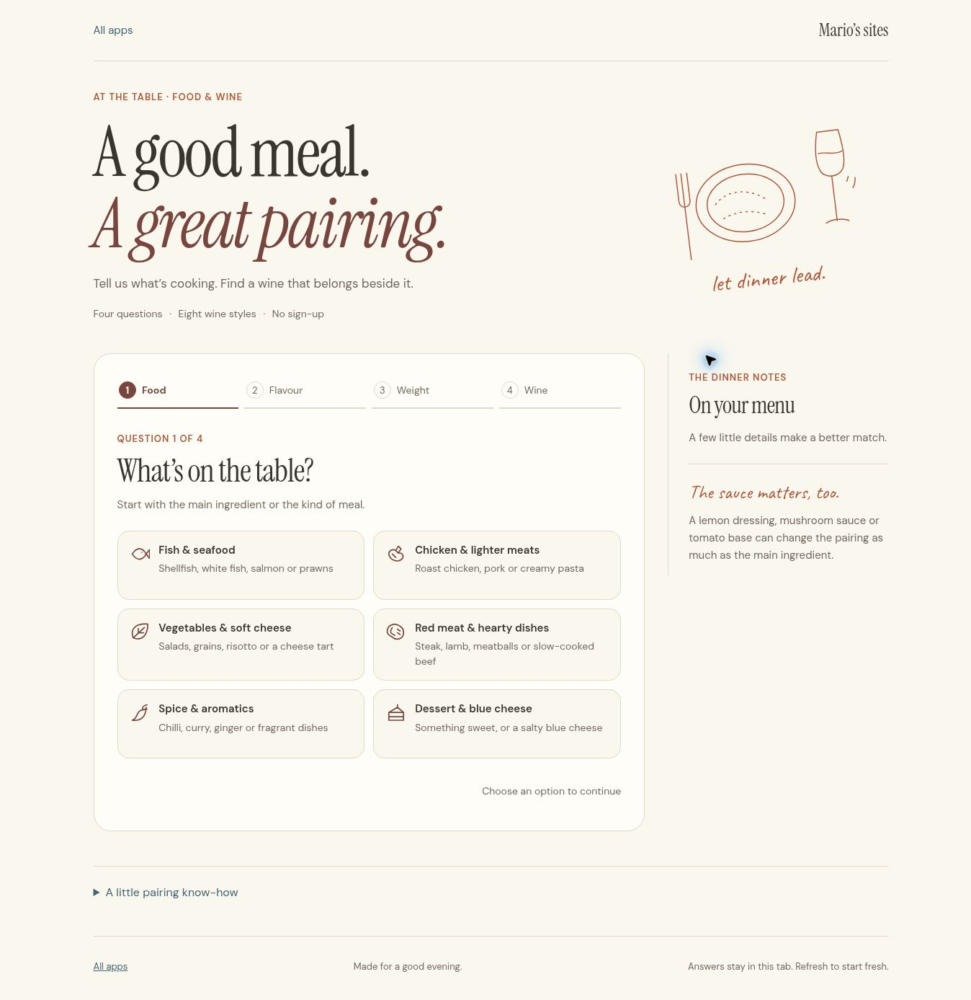

# Food & Wine

A buildless, four-question pairing guide, adapted from `hello-world/` for Mario’s collection. Open `index.html` through the collection’s HTTP preview. Uses `../shared/theme.css` and `../shared/ui.js`; no build, dependencies, accounts, API keys or server are required.



## Use

Choose the main food, dominant flavour, dish weight and preferred wine direction. Each answer advances immediately. Back and the four question controls revisit earlier questions. The dinner notes let you edit any answer, including from results. Editing a completed pairing returns directly to refreshed results. Start again / Pair another meal resets all answers.

The guide selects eight wine **styles**, highlights the strongest pairing fit, and initially sorts those eight by the lower end of their budget range. Switch to Pairing fit to see their editorial ranking. A budget range is not a quote, a current price comparison or a stock check. Sweet wines show the assumed bottle size because formats differ. No producer, vintage, availability or endorsement is implied.

Answers and sorting are transient in this tab. Nothing is saved, submitted, emailed or synchronised. Refreshing resets the guide. No localStorage or analytics are added. Shared web fonts are loaded by the existing theme.

## Matching and editorial data

`pairings.js` owns 64 original catalogue entries, questions and a pure matching function, usable in Node for regression checks. Entries describe typical style profiles; actual bottles vary. Regions are examples to explore. Price bands are deliberately broad editorial AUD planning estimates, maintained manually, not sourced current retailer prices.

Food compatibility, leading flavour, body alignment and acidity contribute to ranking. Chilli penalises tannin and higher alcohol and favours a little sweetness. Delicate seafood penalises firm tannins. Tomato/citrus favour acidity. Weight changes the body preference. Wine direction is a hard filter for savoury meals; an unconventional selected direction can produce exploratory options and appropriate notes.

Dessert/blue cheese always uses the sweet catalogue. The fourth question offers best match or sweet wine for this food. Changing a completed dry-wine pairing to dessert clears the incompatible wine choice and asks that question again. The pure matcher also enforces this constraint for callers outside the UI. Lighter sweet wines include a caution about sugary desserts. No opaque percentages or fabricated review scores are displayed.

The general pairing principles were checked against these primary educational sources; the catalogue and ranking are our editorial interpretation, not their recommendations or a reproduction of a third-party database:

- [Wine Australia: 5 steps to pairing food with wine](https://www.australianwine.com/experience/articles/5-steps-to-pairing-food-with-wine)
- [WSET: Four rules for food and wine pairing](https://www.wsetglobal.com/news-insights/insight-opinion/four-rules-to-masterful-food-and-wine-pairing/)
- [WSET: How to pair drinks with spice](https://www.wsetglobal.com/news-insights/insight-opinion/how-to-pair-drinks-with-spice/)

The interaction was inspired by [The Tasting Guys’ food and wine guide](https://guide.thetastingguys.wine/foodandwine). Its branding, source code, lead-capture form and proprietary recommendation data are not copied. Illustrations and icons are original inline SVG.

## Validation

Run from the repository root:

```sh
python3 scripts/validate.py
node --test tests/food-wine.cjs
```

The matching regression explores all 648 input combinations, style filtering, dessert constraints, uniqueness, both sort orders and representative sauce/weight/chilli cases. Browser checks should cover the four-step flow, nested icon/text clicks, Back, answer editing, dessert conversion, restart, sorting, native details, keyboard focus and immediate feedback, reduced motion, narrow layout and 200% text enlargement. Physical iPhone/Safari feel remains a separate check.

Keep app and manifest changes on a feature branch and open a pull request. The live subpage is published only after an authorised merge and successful GitHub Pages deployment.
